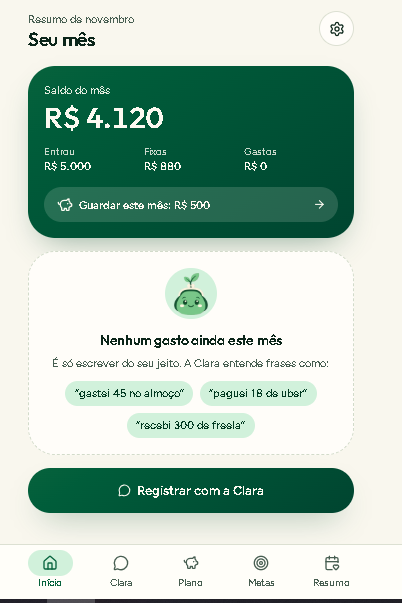
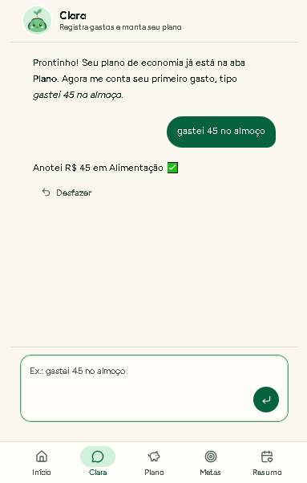
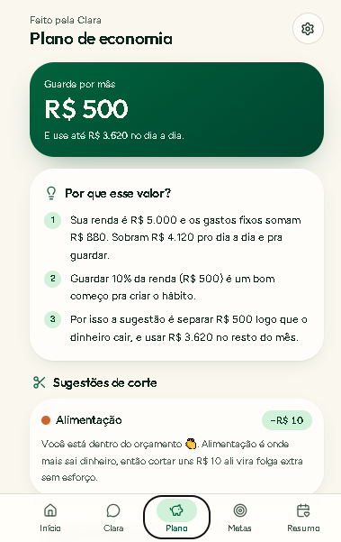

# 💰 Bolso Claro — App de Finanças Pessoais com IA (Vibe Coding)

> Desafio DIO: criar o conceito de um app de organização de finanças pessoais usando Vibe Coding, com Copilot e Lovable.

## 1. Conceito do App

**Bolso Claro** é um app mobile-first que acaba com o controle financeiro manual e cansativo. Em vez de planilhas e categorias para preencher, a pessoa **conversa** com um agente de IA ("Clara") que registra gastos, entende o perfil financeiro e monta planos automáticos de economia.

**Problema:** a maioria das pessoas desiste de controlar as finanças porque lançar gastos dá trabalho e os apps não dizem *o que fazer* com os números.

**Solução:** registro por conversa natural ("gastei 45 no almoço"), categorização automática e um agente que cria metas e planos de economia personalizados, ajustando-os conforme o mês real.

**Público-alvo:** jovens adultos e profissionais que ganham entre 1 e 6 salários mínimos e nunca mantiveram um controle financeiro por mais de duas semanas.

### Funcionalidades do MVP

1. **Chat com a Clara:** registrar receitas e despesas em linguagem natural.
2. **Categorização automática** de gastos (alimentação, transporte, lazer, moradia etc.).
3. **Plano de economia automático:** a IA sugere quanto guardar por mês com base na renda, nos gastos fixos e no objetivo.
4. **Metas:** ex.: "juntar R$ 3.000 para viagem em 8 meses", com barra de progresso.
5. **Dashboard simples:** saldo do mês, gastos por categoria e alerta de orçamento estourando.
6. **Resumo semanal** escrito pela IA, em linguagem simples.

### Fora do MVP (próximas versões)

Integração bancária (Open Finance), leitura de comprovantes por foto, planos em família, investimentos.

### Fluxo de telas

1. **Onboarding:** renda mensal, gastos fixos e objetivo principal (3 perguntas, em formato de conversa).
2. **Home / Dashboard:** saldo, gráfico por categoria, meta em destaque.
3. **Chat com a Clara:** registro de gastos e dúvidas ("posso gastar 200 em um jantar?").
4. **Plano de economia:** valor sugerido por mês e por categoria, com botão "ajustar".
5. **Metas:** lista de objetivos com progresso.
6. **Resumo semanal:** insights e uma ação recomendada para a semana seguinte.

---

## 2. Prompt Final (PRD simplificado)

```text
# PAPEL
Você é um(a) Product Designer e desenvolvedor(a) front-end sênior, especialista em apps financeiros mobile-first e em agentes de IA conversacionais.

# CONTEXTO
Quero criar o "Bolso Claro", um app de finanças pessoais para jovens adultos brasileiros (renda de 1 a 6 salários mínimos) que desistem de controlar o dinheiro porque lançar gastos manualmente é cansativo. O diferencial é um agente de IA chamado "Clara", que registra gastos por conversa e cria planos automáticos de economia.

# OBJETIVO DO MVP
Permitir que a pessoa, em menos de 2 minutos de onboarding, passe a registrar gastos conversando e receba um plano de economia personalizado.

# FUNCIONALIDADES (MVP)
1. Onboarding conversacional: renda mensal, gastos fixos e objetivo principal.
2. Chat com a Clara: registra receitas/despesas a partir de frases como "gastei 45 no almoço" e categoriza automaticamente.
3. Plano de economia: calcula quanto guardar por mês e sugere cortes por categoria, explicando o porquê em linguagem simples.
4. Metas: criar meta (valor + prazo), mostrar progresso e quanto guardar por mês.
5. Dashboard: saldo do mês, gastos por categoria (gráfico de rosca), alerta quando uma categoria passar de 80% do orçamento.
6. Resumo semanal gerado pela IA com 1 insight e 1 ação recomendada.

# FORA DO ESCOPO
Integração bancária, leitura de comprovantes, investimentos, múltiplos usuários.

# REGRAS DO AGENTE "CLARA"
- Tom: amigável, direto e sem julgamento; nunca culpa o usuário por gastos.
- Respostas curtas (até 3 frases), sempre em português do Brasil.
- Se faltar informação (valor ou categoria), faz UMA pergunta por vez.
- Não dá recomendação de investimento; foca em organização e economia.
- Sempre confirma o que registrou: "Anotei R$ 45 em Alimentação ✅".

# TELAS
Onboarding, Dashboard, Chat, Plano de Economia, Metas, Resumo Semanal.

# DESIGN
Mobile-first, visual limpo e acolhedor, paleta verde e off-white, cantos arredondados, fonte sem serifa, modo escuro opcional. Acessibilidade: contraste AA e botões grandes.

# DADOS (mock para o MVP)
Use dados de exemplo realistas em reais (R$) e armazene localmente; sem backend nesta etapa.

# ENTREGÁVEIS
1. Fluxo de telas descrito em tópicos.
2. Código do protótipo navegável (React + Tailwind).
3. Prompt de sistema do agente Clara.
4. Lista de melhorias para a versão 2.

# HISTÓRIAS DE USUÁRIO
- Como usuário, quero digitar "gastei 45 no almoço" para registrar sem abrir formulários.
- Como usuário, quero um plano de economia pronto para não precisar calcular nada.
- Como usuário, quero ser avisado quando estiver perto do limite de uma categoria.

# ESTADOS E ERROS
- Estado vazio: antes do primeiro gasto, mostrar exemplos de frases que a Clara entende.
- Frase ambígua ("gastei 50"): a Clara pergunta a categoria em vez de adivinhar.
- Sem renda informada: bloquear o plano e pedir a renda de forma amigável.

# MÉTRICAS DE SUCESSO
- 70% dos usuários registram ao menos 3 gastos na primeira semana.
- Tempo médio para registrar um gasto abaixo de 10 segundos.
- 50% dos usuários criam uma meta nos primeiros 7 dias.

# PRIVACIDADE
Dados financeiros são sensíveis: armazenar apenas o necessário, avisar o usuário sobre o uso dos dados (LGPD) e nunca pedir senhas bancárias.

# CRITÉRIOS DE ACEITE
- O usuário registra um gasto digitando uma frase e o vê no dashboard.
- O plano de economia muda quando a renda ou a meta mudam.
- Todas as telas funcionam em 375px de largura.
```

### Como o prompt evoluiu

| Versão | O que mudou |
|---|---|
| v1 | "Crie um app de finanças com IA": resultado genérico, sem foco. |
| v2 | Adicionei público-alvo, problema e lista de funcionalidades. |
| v3 | Defini o papel da IA, o escopo (dentro e fora) e as regras da Clara. |
| v4 | Incluí design, dados mock, entregáveis e critérios de aceite. |
| v5 (final) | Refinada com assistente de IA: acrescentei histórias de usuário, estados vazios e de erro, métricas de sucesso e privacidade (LGPD). |

---

## 3. Interações com as ferramentas

### Assistente de IA (refinamento do prompt)

Usei um assistente de IA para revisar o PRD. Ele apontou que faltavam histórias de usuário, tratamento de estados vazios e erros, métricas de sucesso e cuidados com privacidade, e eu incorporei esses pontos na versão final.

<!-- INSERIR AQUI: prints da conversa de refinamento -->


### Lovable (geração do protótipo)

<!-- INSERIR AQUI: prints das telas geradas no Lovable -->




🔗 Link do protótipo: _inserir link do projeto no Lovable_

---

## 4. Reflexão

Neste desafio percebi que programar com IA começa muito antes do código: a qualidade do resultado depende da qualidade do briefing. Minhas primeiras versões do prompt geraram telas genéricas; só quando defini público, problema, escopo e regras do agente é que a IA entregou algo coerente.

Três aprendizados principais:

- **Escopo claro evita retrabalho.** Dizer o que está *fora* do MVP foi tão importante quanto listar o que entra.
- **Iterar é parte do processo.** Cada rodada com o Copilot deixou o PRD mais objetivo, e o Lovable respondeu melhor a prompts estruturados.
- **A IA acelera, mas o julgamento é meu.** Precisei revisar fluxos, textos e decisões de produto, como o tom da Clara, que não deve culpar o usuário.

Se eu fosse continuar, o próximo passo seria conectar um backend real, testar o agente com usuários e medir se o registro por conversa realmente aumenta a constância do controle financeiro.

---

## 5. Estrutura do repositório

```
├── README.md
└── imagens/
    ├── refinamento-01.png
    ├── refinamento-02.png
    ├── lovable-dashboard.png
    ├── lovable-chat.png
    └── lovable-plano.png
```

---
👤 Autor(a):Smyrna Ramos · [GitHub](https://github.com/Rapunzelmina)
